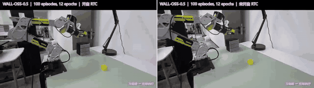
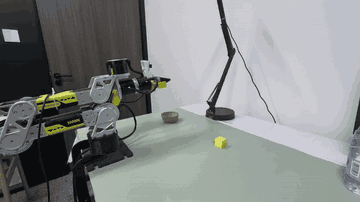
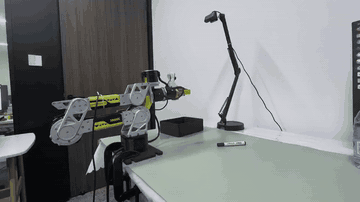
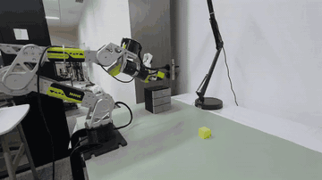
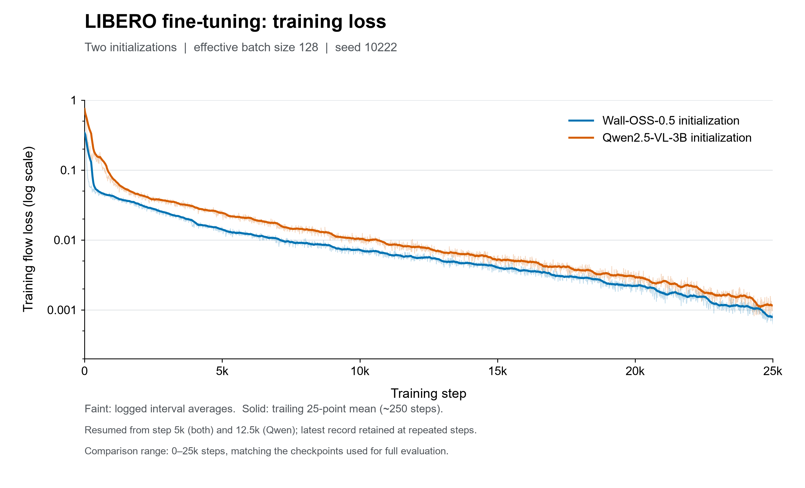
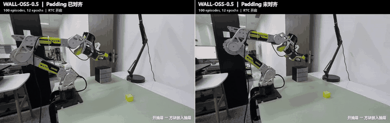

# Wall-X: LIBERO, RoboTwin 2.0 and ReBot

[中文](README.zh-CN.md) · [🎬 Video showcase](https://juxingyiwan.github.io/wall-x/showcase.html) · [Upstream Wall-X](https://github.com/X-Square-Robot/wall-x) · [Contributing](CONTRIBUTING.md) · [All CI checks](https://github.com/juxingyiwan/wall-x/actions)

[](https://github.com/juxingyiwan/wall-x/actions/workflows/core-tests.yml) [](https://github.com/juxingyiwan/wall-x/actions/workflows/deployment.yml)

**Train Wall-X policies, evaluate them in simulation and deploy them on ReBot / B601.**

Built on [X-Square Robot / Wall-X](https://github.com/X-Square-Robot/wall-x), this repository brings LIBERO, RoboTwin 2.0 and ReBot into one codebase, with a separate environment and complete guide for each workflow.

- **Training and evaluation:** demonstration preparation, checkpoint resume and task-level evaluation reports.
- **Real-robot deployment:** local or network inference, RTC (real-time chunking) and Rerun visualization.
- **Action alignment:** shared training/inference padding alignment, with a robot comparison and offline ablation.

[Get started](#workflows) · [Robot demonstrations](#rebot-demos) · [Experimental results](#experiments) · [Technical development notes](#development)

<a id="rebot-results"></a>

## ReBot: Wall-OSS-0.5 with and without RTC

Wall-OSS-0.5 on the real robot: **RTC (real-time chunking) enabled on the left, disabled on the right**. The silent animation shows the complete comparison at its original speed. Click it to open the full-resolution video player.

[](https://juxingyiwan.github.io/wall-x/#rtc)

[🎬 Watch RTC comparison · 19.9 s](https://juxingyiwan.github.io/wall-x/#rtc) · [Operating steps](docs/rebot.md#operate) · [Action-padding notes and ablation](#action-padding)

<a id="rebot-demos"></a>

## ReBot: task demonstrations

The silent animations show each complete demonstration at its original speed. Click a preview to play the full-resolution video with sound and fullscreen controls. Each heading is the full task instruction passed to the policy.

[🎬 Video showcase](https://juxingyiwan.github.io/wall-x/showcase.html)

| `Grasp the cube to the bowl` | `Grasp the pen to the box` | `Grasp the cube into the closed top drawer` |
| --- | --- | --- |
| [](https://juxingyiwan.github.io/wall-x/showcase.html#cube) | [](https://juxingyiwan.github.io/wall-x/showcase.html#pen) | [](https://juxingyiwan.github.io/wall-x/showcase.html#drawer) |
| [🎬 Watch video · 12.0 s](https://juxingyiwan.github.io/wall-x/showcase.html#cube) | [🎬 Watch video · 11.4 s](https://juxingyiwan.github.io/wall-x/showcase.html#pen) | [🎬 Watch video · 13.4 s](https://juxingyiwan.github.io/wall-x/showcase.html#drawer) |

<a id="workflows"></a>

## Choose one workflow

Clone the repository and record the printed commit ID for your run. Follow the selected guide's environment and resource setup before running the first task.

```bash
git clone https://github.com/juxingyiwan/wall-x.git
cd wall-x
git rev-parse HEAD
```

| Goal | First task | Complete guide |
| --- | --- | --- |
| Evaluate or train on LIBERO | With a trained checkpoint, run [one evaluation episode](docs/libero.md#evaluate); for a new model, start with [demonstrations and training](docs/libero.md#data) | [English](docs/libero.md) · [中文](docs/libero.zh-CN.md) |
| Evaluate or train on RoboTwin 2.0 | Start with the [two-task dataset](docs/robotwin.md#data); with a trained checkpoint, run the [evaluation dry run](docs/robotwin.md#evaluate) | [English](docs/robotwin.md) · [中文](docs/robotwin.zh-CN.md) |
| Run ReBot / B601 | Prepare the [robot and checkpoint configuration](docs/rebot.md#configuration), then [replay recorded observations](docs/rebot.md#replay) before [robot operation](docs/rebot.md#operate) | [English](docs/rebot.md) · [中文](docs/rebot.zh-CN.md) |

Prepare the following resources before starting; download and training commands are in each guide.

| Resource | How to obtain it |
| --- | --- |
| Wall-OSS-0.5 foundation weights and Qwen processor | Download the pinned versions in the [LIBERO](docs/libero.md#assets), [RoboTwin](docs/robotwin.md#assets) or [ReBot](docs/rebot.md) guide |
| LIBERO / RoboTwin demonstrations | Download the public datasets in the guides; the RoboTwin full-data route also includes independent development-set collection |
| ReBot demonstrations and replay observations | Collect your own and convert them with the [ReBot guide](docs/rebot.md#data) |
| Task checkpoints for all three workflows | Train using the guides and retain configuration and normalizers; this repository has not yet published the task weights used in the experiments |

Model training and inference use Linux, an NVIDIA GPU, CUDA and Conda. Each workflow has its own environment; RoboTwin uses an additional simulator environment with NVIDIA/Vulkan graphics and simulator assets.

ReBot requires a B601 arm, two cameras and a compatible trained checkpoint. The GPU can run on the robot host or on a separate model server. Run guide commands from the repository root and replace placeholder paths with your own.

<a id="experiments"></a>

## Experimental results

The guides provide pinned foundation-model and data downloads, training configurations and evaluation commands. Evaluation uses a trained task checkpoint with its saved configuration and normalization statistics.

Reproduction entry points: [LIBERO resources](docs/libero.md#assets) · [LIBERO training and split](docs/libero.md#train) · [LIBERO evaluation](docs/libero.md#evaluate) · [RoboTwin resources](docs/robotwin.md#assets) · [RoboTwin five-task protocol and seeds](docs/robotwin.md#reported-settings).

<a id="libero-results"></a>

### LIBERO

Both initializations use the Wall-X action architecture and full-parameter training: effective batch 128, seed 10222, a 30,000-step cosine schedule and evaluation at 25,000 updates. Each suite contains 10 tasks with 50 trials/task (2,000 trials per initialization). The Qwen initialization loads the pretrained vision-language backbone with a newly initialized action expert. See the [training and evaluation settings](docs/libero.md#train).

| Suite | Wall-OSS-0.5 initialization | Qwen2.5-VL-3B initialization |
| --- | --- | --- |
| Spatial | 98.8% (494/500) | 98.2% (491/500) |
| Object | 99.6% (498/500) | 100.0% (500/500) |
| Goal | 98.4% (492/500) | 98.8% (494/500) |
| Long | 96.0% (480/500) | 94.6% (473/500) |
| **Overall** | **98.2% (1964/2000)** | **97.9% (1958/2000)** |

Each initialization uses one training run. The [training template](workspace/example/libero.yml) and [reported-run settings](docs/libero.md#train) specify the two initializations and data split.



Training flow loss through 25,000 steps, with a logarithmic vertical axis. Faint lines show logged interval averages; solid lines show a trailing 25-point mean (about 250 steps).

The results indicate that the foundation model pretrained on robot data converges faster on LIBERO. With sufficient training for both initializations, their final success rates are similar.

<a id="robotwin-results"></a>

### RoboTwin 2.0

Five-task training uses 50 clean + 500 randomized demonstrations per task (2,750 total), effective batch 256 and a checkpoint at 30,000 completed updates. Evaluation uses unseen instructions, 32 predicted / 16 executed actions and **100 expert-valid trials per task and condition**: 500 Clean + 500 Randomized trials. See the [evaluation settings](docs/robotwin.md#reported-settings) for scenes and seeds. Success rates use valid evaluation episodes across the five tasks. Policy failures count in the denominator; expert-invalid scenes are excluded before evaluation.

| Task | Clean successes/trials | Randomized successes/trials |
| --- | --- | --- |
| `open_microwave` | 67/100 | 85/100 |
| `click_bell` | 71/100 | 92/100 |
| `stack_blocks_three` | 79/100 | 78/100 |
| `place_shoe` | 97/100 | 96/100 |
| `put_object_cabinet` | 76/100 | 82/100 |
| **Five-task mean** | **78.0% (390/500)** | **86.6% (433/500)** |

The results show a higher mean success rate for Randomized (**86.6%**) than for Clean (**78.0%**). Possible reasons are:

1. **Training is dominated by Randomized data.** Randomized accounts for **90.8% of training frames**, with sampling not balanced between the two conditions, so the model may be better adapted to randomized scenes.
2. **Evaluation scenes are not paired across conditions.** Scenes are generated and screened for expert validity separately for each condition. Randomization consumes random draws before object generation, so even identical seeds can yield different object variants, layouts and manipulation difficulty, affecting the two success rates.

The gap is concentrated in `open_microwave` (+18 percentage points) and `click_bell` (+21 percentage points), which together contribute **7.8 percentage points, about 91% of the overall 8.6-percentage-point gap**.

<a id="upstream"></a>

## Wall-X documentation

Official documentation from revision `ce2a1ae31d9ee1028b97ca40e3f66034cf8c0e5f`, with the official homepages saved as `README.upstream.*`. Use the workflow guides above for this repository.

| Original material | Location |
| --- | --- |
| Official overview, models, community and citation | [English](README.upstream.md) · [中文](README.upstream.zh-CN.md) |
| Original usage and script documentation | [Workspace](workspace/README.md) · [Scripts](scripts/README.md) |
| Original hardware examples | [Flowers](workspace/TRAIN_ARRANGE_3_FLOWERS.md) · [RTX 5090 setup](workspace/rtx5090/README.md) · [Deployment](workspace/rtx5090/DEPLOY.md) · [Original notes](workspace/rtx5090/local/NOTES.md) |

<a id="contribute"></a>

## Contribute and develop

See [Contributing](CONTRIBUTING.md) ([中文](CONTRIBUTING.zh-CN.md)) for tests and PR preparation, and [Technical development notes](#development) ([中文](README.zh-CN.md#development)) for implementation details. The project uses [Apache-2.0](LICENSE); third-party attribution is in the [source notices](NOTICE.txt) and [client notices](deployment/client/NOTICE.txt).

Models, datasets and simulators retain their own licenses. Model and dataset sources (pinned revisions): [Wall-OSS-0.5](https://huggingface.co/X-Square-Robot/wall-oss-0.5/tree/b7dc23a82dbf70a65859c9fdd596703234597028) · [Qwen2.5-VL-3B](https://huggingface.co/Qwen/Qwen2.5-VL-3B-Instruct/tree/66285546d2b821cf421d4f5eb2576359d3770cd3) · [LIBERO](https://huggingface.co/datasets/lerobot/libero/tree/a1aaacb7f6cd6ee5fb43120f673cebb0cfea7dd4) · [RoboTwin 2.0](https://huggingface.co/datasets/TianxingChen/RoboTwin2.0/tree/3dc3b798668feb99ac61cc9086d84cbcc3d79186) · [RoboTwin LeRobot](https://huggingface.co/datasets/robbyant/robotwin-clean-and-aug-lerobot/tree/595d4acc7e026aa57afba218f4170c6d79e39103).

<a id="development"></a>

## Technical development notes

This section covers component ownership, implementation analysis and homing bounds. See the [three workflows](#workflows) for operating procedures and [Contributing](CONTRIBUTING.md) for checks.

<a id="ownership"></a>

### Component ownership

| Component | Responsibility |
| --- | --- |
| `wall_x/model`, `data`, `config`, `trainer`, `_vendor/harrix` | Upstream core; shared padding, loader and recovery patches remain here |
| `wall_x/robotwin`, `scripts/*robotwin*` | RoboTwin conversion/training/evaluation and isolated simulator workers |
| `wall_x/data/b601*`, `wall_x/trainer/adapters/b601*` | B601 preparation, representation and recovery |
| `deployment/`, `deployment/client/` | Model backends/launcher and independently packaged hardware controller |
| `environments/`, `workspace/example/` | Dependency profiles and public configuration templates |

<a id="implementation-analysis"></a>

### Wall-X improvements and analysis

<a id="action-padding"></a>

#### Action padding: training/inference alignment

This experiment was motivated by action jitter observed during ReBot deployment and targets a mismatch already present in [upstream Wall-X ce2a1ae](https://github.com/X-Square-Robot/wall-x/blob/ce2a1ae31d9ee1028b97ca40e3f66034cf8c0e5f/wall_x/model/qact/qwen2_5/modeling_qwen2_5_vl_act.py#L2080-L2092). B601 uses seven physical action channels (six arm joints and a gripper), padded to the model's 26 dimensions. Training normalizes the physical channels before appending zeros; the upstream inference path instead maps raw zero to -1 when [checkpoint statistics already cover all 26 dimensions](https://github.com/X-Square-Robot/wall-x/blob/ce2a1ae31d9ee1028b97ca40e3f66034cf8c0e5f/wall_x/model/core/action/normalizer.py#L98-L109), with `min=0, delta=1` in the virtual channels. Although excluded from the loss, virtual channels still enter the shared action encoder and can affect physical outputs. The ablation measures the effect of restoring the training-time zero endpoint on predicted-action smoothness.

<a id="padding-video"></a>

##### Real-robot comparison

Wall-OSS-0.5 was trained on 100 demonstrations for 12 epochs to open a drawer and place a block inside. RTC is enabled in both runs; only action padding alignment changes: aligned on the left, unaligned on the right.

[](https://juxingyiwan.github.io/wall-x/#padding)

[🎬 Watch padding comparison · 16.0 s](https://juxingyiwan.github.io/wall-x/#padding)

<a id="padding-offline"></a>

##### Offline prediction ablation

Six checkpoints were replayed on recorded robot observations with matched weights, observations and noise within each pair. Only the virtual action endpoint changed from -1 to 0; state/masks were fixed, with RTC, smoothing and clipping disabled. Across 900 paired predictions, the zero endpoint reduced the metric in all 900 pairs.

For each prediction, smoothness is measured by the mean absolute second difference over the first $K = 16$ steps and $D = 6$ arm joints:

$$
J = \frac{1}{D(K-2)}
    \sum_{j=1}^{D}\sum_{k=0}^{K-3}
    \left|q_{k+2,j} - 2q_{k+1,j} + q_{k,j}\right|.
$$

Here $q_{k,j}$ is the predicted angle of joint $j$ at step $k$, in degrees. The mean covers 14 second differences per joint (84 terms in total). The unit is degrees/sample-step²; lower is smoother. Values below pool the corresponding checkpoints by pair count.

| Task | Prediction pairs | Upstream padding | Aligned padding | Reduction |
| --- | --- | --- | --- | --- |
| Bowl | 360 | 2.958 | 0.262 | 91.1% |
| Drawer | 270 | 2.334 | 0.206 | 91.2% |
| Pen | 270 | 2.557 | 0.263 | 89.7% |

These checkpoints used absolute joint actions; the current B601 template uses delta actions. See [ReBot configuration](docs/rebot.md#data).

<a id="homing"></a>

### Homing bounds

The following constants control the nominal homing sweep and gripper-zero checks. Check the full arm path for obstacles before operation. Keep the values aligned with source and test feedback-loss and timeout paths with fake devices:

| Source constant | Value | Meaning |
| --- | --- | --- |
| `front_home.FORWARD_LIMIT_M` | `0.5` | Forward plane (m) |
| `front_home.CLEARANCE_M` | `0.03` | Nominal margin (m) |
| `zero_servo.ZERO_PRECISION_DEG` | `0.5` | Maximum gripper zero error (degrees) |
| `zero_servo.MAX_REFINEMENT_S` | `10.0` | Refinement deadline (s) |

<a id="source"></a>

### Authoritative implementation references

Use [padding](wall_x/inference_padding.py), [checkpoint selection](wall_x/checkpoint_weights.py), the [client configuration](deployment/client/src/wallx_client/config.py), [wire protocol](deployment/client/src/wallx_client/protocol.py) and [sample manifest](deployment/client/docs/examples/server_manifest.json) when changing behavior. Inspect actual parsers through `--help`. Retain third-party attribution in [NOTICE](NOTICE.txt) and the [client notice](deployment/client/NOTICE.txt).
