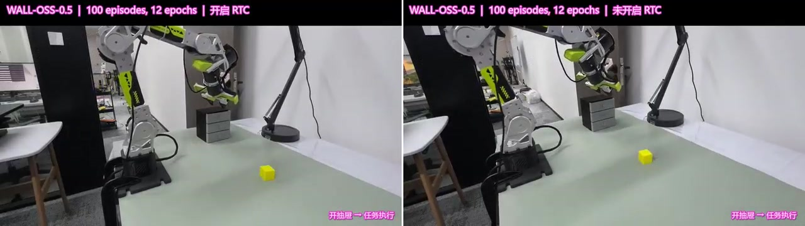
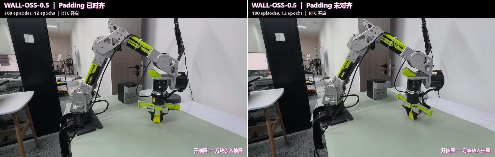

# Wall-X：LIBERO、RoboTwin 2.0 与 ReBot

[English](README.md) · [总导航](README.zh-CN.md)

基于 [X-Square Robot / Wall-X](https://github.com/X-Square-Robot/wall-x)，提供 LIBERO、RoboTwin 2.0 和 ReBot / B601 的训练、评估与部署流程。

## 选择一条使用路线

| 使用路线 | 完整指南 |
| --- | --- |
| LIBERO：安装、数据准备、训练、恢复与评估 | [English](docs/libero.md) · [中文](docs/libero.zh-CN.md) |
| RoboTwin 2.0：模型/模拟器安装、转换、训练与评估 | [English](docs/robotwin.md) · [中文](docs/robotwin.zh-CN.md) |
| ReBot / B601：安装、数据/训练、本地/网络推理、同步与 RTC | [English](docs/rebot.md) · [中文](docs/rebot.zh-CN.md) |

各场景使用独立 Conda 环境，RoboTwin 另设模拟器环境。每份指南包含环境配置、资源准备、运行命令与排错。

克隆本仓库后，在仓库根目录执行指南中的命令并替换占位路径。模型训练与推理需要 Linux、NVIDIA GPU 和 CUDA。基础模型下载、数据准备及 checkpoint 使用方法见各场景指南。

## 实验结果

各场景的训练配置与评估流程见对应指南。

### LIBERO

两种初始化均使用 Wall-X 动作模型结构并进行全参数训练：有效 batch 128、seed 10222、30,000 步余弦调度，在 25,000 次更新时评估。每个套件含 10 个任务、每任务 50 次，每种初始化共 2,000 次。Qwen 初始化加载预训练视觉语言骨干，动作专家重新初始化。具体见[训练与评估设置](docs/libero.zh-CN.md#train)。

| 套件 | Wall-OSS-0.5 初始化 | Qwen2.5-VL-3B 初始化 |
| --- | --- | --- |
| Spatial | 98.8% (494/500) | 98.2% (491/500) |
| Object | 99.6% (498/500) | 100.0% (500/500) |
| Goal | 98.4% (492/500) | 98.8% (494/500) |
| Long | 96.0% (480/500) | 94.6% (473/500) |
| **总体** | **98.2% (1964/2000)** | **97.9% (1958/2000)** |

每种初始化各训练一轮。

前 25,000 步的训练 flow loss，纵轴采用对数刻度。浅色线为日志区间均值，实线为最近 25 个记录点的滑动均值（约 250 步）。

### RoboTwin 2.0

五任务训练每任务使用 50 条 clean + 500 条 randomized 演示，共 2,750 条，有效 batch 256，评估 checkpoint 完成了 30,000 次更新。评估采用 unseen 指令、预测 32 步/执行 16 步，**每任务、每种设置各 100 个专家有效回合**：Clean 500 次，Randomized 500 次。具体场景与种子见[评估设置](docs/robotwin.zh-CN.md#reported-settings)。

| 任务 | Clean 成功数/总次数 | Randomized 成功数/总次数 |
| --- | --- | --- |
| `open_microwave` | 67/100 | 85/100 |
| `click_bell` | 71/100 | 92/100 |
| `stack_blocks_three` | 79/100 | 78/100 |
| `place_shoe` | 97/100 | 96/100 |
| `put_object_cabinet` | 76/100 | 82/100 |
| **五任务平均** | **78.0% (390/500)** | **86.6% (433/500)** |

成功率按五个任务的有效评估回合计算，策略失败计入分母，专家无效场景在评估前排除。

### ReBot：Wall-OSS-0.5 与 RTC

Wall-OSS-0.5 真机对比：**左侧开启 RTC（实时动作分块），右侧未开启 RTC**。点击预览图观看原始并排对比视频。

[播放对比视频](assets/rebot_walloss05_rtc_comparison.mp4) · [运行步骤](docs/rebot.zh-CN.md#operate) · [Action padding 技术说明与消融](#action-padding)

## Wall-X 相关文档

以下为官方 `ce2a1ae31d9ee1028b97ca40e3f66034cf8c0e5f` 版本文档，官方首页保存在 `README.upstream.*`。本仓库的三条使用路线见上方导航。

| 原生内容 | 位置 |
| --- | --- |
| 官方介绍、模型、社区与引用 | [English](README.upstream.md) · [中文](README.upstream.zh-CN.md) |
| 原生使用与脚本说明 | [Workspace](workspace/README.md) · [Scripts](scripts/README.md) |
| 原生硬件示例 | [插花](workspace/TRAIN_ARRANGE_3_FLOWERS.md) · [RTX 5090 安装](workspace/rtx5090/README.md) · [部署](workspace/rtx5090/DEPLOY.md) · [原有记录](workspace/rtx5090/local/NOTES.md) |

## 贡献与开发

测试与 PR 准备见[贡献指南](CONTRIBUTING.zh-CN.md)（[English](CONTRIBUTING.md)），实现要点见[技术开发说明](#development)（[English](README.md#development)）。项目采用 [Apache-2.0](LICENSE)；第三方归属见[来源声明](NOTICE.txt)和[客户端声明](deployment/client/NOTICE.txt)，模型与数据遵循各自许可。

## 技术开发说明

本节说明模块分工、优化分析与归位边界。操作流程见[三条使用路线](#workflows)，检查要求见[贡献指南](CONTRIBUTING.zh-CN.md)。

### 模块分工

| 模块 | 职责 |
| --- | --- |
| `wall_x/model`、`data`、`config`、`trainer`、`_vendor/harrix` | 原生核心；共享 padding、loader 与恢复补丁保留在此 |
| `wall_x/robotwin`、`scripts/*robotwin*` | RoboTwin 转换/训练/评估及隔离的模拟器 worker |
| `wall_x/data/b601*`、`wall_x/trainer/adapters/b601*` | B601 数据准备、表示和恢复 |
| `deployment/`、`deployment/client/` | 模型后端/启动器及可独立打包的硬件控制器 |
| `environments/`、`workspace/example/` | 依赖组合和公开配置模板 |

### Wall-X 优化与分析

#### Action padding：训练与推理对齐

这个实验源于 ReBot 部署中观察到的动作抖动，针对的是 [Wall-X 原版 ce2a1ae](https://github.com/X-Square-Robot/wall-x/blob/ce2a1ae31d9ee1028b97ca40e3f66034cf8c0e5f/wall_x/model/qact/qwen2_5/modeling_qwen2_5_vl_act.py#L2080-L2092) 中已存在的训练与推理不一致。B601 的 7 个真实动作通道（6 个机械臂关节和 1 个夹爪）需要补齐到模型的 26 维。训练时先归一化真实通道，再补零；原版推理在[checkpoint 统计量已覆盖全部 26 维](https://github.com/X-Square-Robot/wall-x/blob/ce2a1ae31d9ee1028b97ca40e3f66034cf8c0e5f/wall_x/model/core/action/normalizer.py#L98-L109)、虚拟通道为 `min=0, delta=1` 时，会把原始零值归一化为 -1。虚拟通道虽然不参与损失计算，仍进入共享的动作编码器，可能影响真实关节输出。消融比较将虚拟动作终点恢复为训练时的 0 前后，预测动作平滑性的变化。

##### 真机效果对比

Wall-OSS-0.5 使用 100 条演示、训练 12 个 epoch，执行“开抽屉 → 方块放入抽屉”。两组均开启 RTC，仅切换 action padding 对齐：左侧已对齐，右侧未对齐。

[播放对比视频](assets/rebot_walloss05_padding_comparison.mp4)

##### 离线预测消融

使用 6 份 checkpoint 回放真机历史观测，每组配对保持权重、观测和噪声相同，仅将虚拟动作终点从 -1 改为 0；state/mask 固定，RTC、平滑和裁剪关闭。共 900 组配对预测，零终点在全部 900 组中降低了该指标。

对每组预测，使用前 $K = 16$ 步、$D = 6$ 个机械臂关节的平均绝对二阶差分衡量平滑性：

$$
J = \frac{1}{D(K-2)}
    \sum_{j=1}^{D}\sum_{k=0}^{K-3}
    \left|q_{k+2,j} - 2q_{k+1,j} + q_{k,j}\right|.
$$

其中，$q_{k,j}$ 为第 $k$ 步、第 $j$ 个关节的预测角度，单位为度。每个关节有 14 个二阶差分，共对 84 项取平均。指标单位为度/采样步²，越小越平滑。下表按配对数汇总相关 checkpoint。

| 任务 | 配对数 | 终点 -1 | 终点 0 | 降幅 |
| --- | --- | --- | --- | --- |
| Bowl | 360 | 2.958 | 0.262 | 91.1% |
| Drawer | 270 | 2.334 | 0.206 | 91.2% |
| Pen | 270 | 2.557 | 0.263 | 89.7% |

这些 checkpoint 使用绝对关节动作，当前 B601 模板使用增量动作。相关设置见 [ReBot 配置](docs/rebot.zh-CN.md#data)。

### 归位边界

以下常量控制名义归位扫掠与夹爪零位检查。操作前检查完整机械臂路径中的障碍物。数值与源码保持一致，使用假设备测试反馈丢失和超时路径：

| 源码常量 | 值 | 含义 |
| --- | --- | --- |
| `front_home.FORWARD_LIMIT_M` | `0.5` | 前向平面（米） |
| `front_home.CLEARANCE_M` | `0.03` | 名义裕量（米） |
| `zero_servo.ZERO_PRECISION_DEG` | `0.5` | 夹爪零位误差上限（度） |
| `zero_servo.MAX_REFINEMENT_S` | `10.0` | 细化时限（秒） |

### 实现依据

变更行为时对照 [padding](wall_x/inference_padding.py)、[权重选择](wall_x/checkpoint_weights.py)、[客户端配置](deployment/client/src/wallx_client/config.py)、[线协议](deployment/client/src/wallx_client/protocol.py)和[示例 manifest](deployment/client/docs/examples/server_manifest.json)。通过 `--help` 查询实际参数解析器，保留 [NOTICE](NOTICE.txt)及[客户端声明](deployment/client/NOTICE.txt)中的第三方归属。
